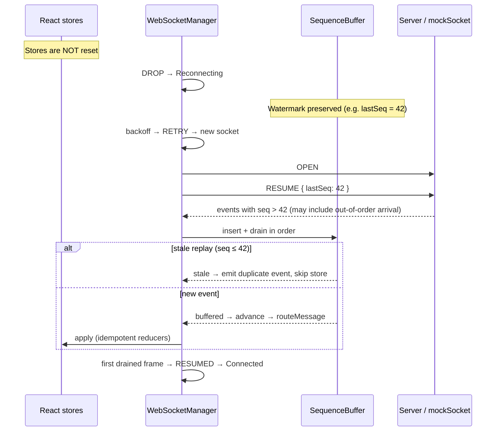
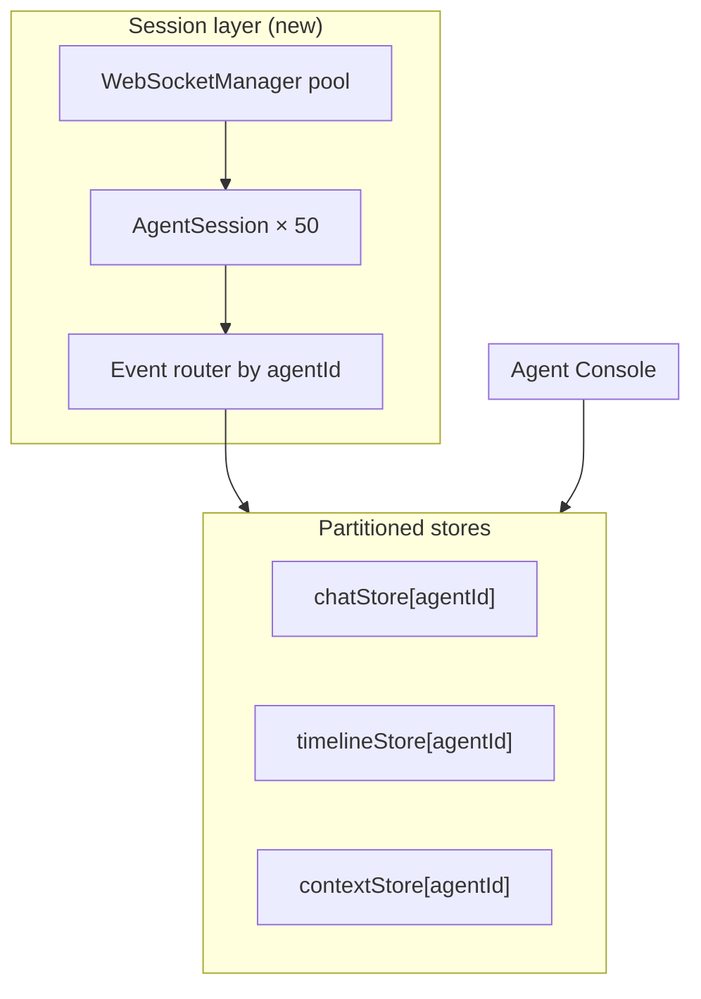

# Architecture decisions

This document records the non-obvious choices in Agent Console: what we picked,
what we rejected, and how the system scales.

---

## 1. Why Zustand (not Redux, not Context)

### Decision

Use **Zustand** stores as the single application state layer. No Redux. No React
Context for domain data.

### Rationale

| Concern | Zustand fit |
| ------- | ----------- |
| **High-frequency updates** | Components subscribe with selectors (`useStore(s => s.order)`). Only subscribers to changed slices re-render. |
| **Outside React** | `useChatStore.getState()` is callable from `useWebSocket` without a provider tree — critical because the socket bridge is not a component. |
| **Boilerplate** | A store is a plain object + actions. No actions/reducers/dispatch ceremony for what is mostly append-only transcript state. |
| **Testability** | Stores reset in tests (`getState().reset()`). No DOM, no providers. |
| **Bundle / complexity** | Redux middleware, normalized entity caches, and Context re-render storms are unnecessary for a focused console with five stores. |

### What we avoided

- **Context API** — every token would notify all consumers unless split into many
  contexts; that is manual selector work with worse ergonomics.
- **Redux** — excellent for large teams and time-travel debugging, but adds
  indirection without payoff here. The hard logic lives in `protocol/` and
  `lib/streaming.ts`, not in middleware.

### Store split

| Store | Responsibility |
| ----- | -------------- |
| `chatStore` | Transcript (messages + tool cards) via `lib/streaming.ts` reducer |
| `timelineStore` | Structural trace index + volatile per-row token text |
| `contextStore` | Bounded snapshot history |
| `websocketStore` | Connection snapshot for UI chrome |
| `selectionStore` | Cross-panel highlight / scroll targets |

Each store owns one concern. The WebSocket hook fans events out; components never
parse frames.

---

## 2. Why SequenceBuffer

### Decision

Use a **pull-based `SequenceBuffer`** inside `WebSocketManager` as the single
ordering and deduplication gate before any store write.

### Problem

WebSocket delivery is unreliable:

- Frames can arrive **out of order** (multiplexing, retries, proxy buffering).
- Frames can arrive **twice** (at-least-once delivery, reconnect replay).
- The UI must still apply events in **strict ascending `seq`** with no gaps.

### Why not apply events directly in `onmessage`?

Direct application would:

1. Corrupt transcript order when seq 3 arrives before seq 2.
2. Double-apply tokens on reconnect when the server replays already-seen seqs.
3. Couple transport concerns to every store reducer.

### SequenceBuffer contract

```
insert(event)  →  "buffered" | "duplicate" | "stale"
nextProcessable()  →  peek seq (highestProcessed + 1)
markProcessed() / drain()  →  advance watermark
```

- **`stale`** — `seq <= highestProcessed` (already consumed, including post-replay dupes).
- **`duplicate`** — same seq still sitting in the buffer.
- **Gap** — buffer holds seq 4 but not 3; nothing is released past the gap.

When a gap persists, `WebSocketManager` applies a **gap policy** (defaults:
`maxBuffer: 256`, `maxGapAgeMs: 5000`). If buffered out-of-order frames exceed
the cap or the gap ages out, the manager emits `seqGap` (for diagnostics) and
**reconnects** so `RESUME` can fill the hole — it never skips seqs silently like
`ReorderBuffer` would.

### Why not only ReorderBuffer?

`reorderBuffer.ts` is a **push-based** variant with safety valves (overflow and
timeout) that can **skip gaps** when the transport is permanently lossy. That is
useful for telemetry pipelines.

`SequenceBuffer` is **strict**: it never invents missing seqs. For an agent
console, a gap means "wait for replay" — exactly what `RESUME` provides after
reconnect. Losing a frame silently would corrupt the transcript.

### Alternative considered

Server-assigned **vector clocks per stream** — rejected for v1 because the wire
protocol already exposes a single monotonic session `seq`, and the client must
honor it for resume anyway.

---

## 3. Why a state machine (not boolean flags)

### Decision

Model the connection lifecycle as an explicit **8-state FSM** with a declarative
transition table in `protocol/stateMachine.ts`.

### Problem with flags

A production WebSocket client typically needs to distinguish:

- First connect vs reconnect
- Intentional close vs transient drop
- Mid-stream resume vs idle connected
- Tool-call pause vs streaming

Expressing this with `isConnected`, `isReconnecting`, `isResuming`,
`intentionalClose` leads to **illegal compound states** (`isConnected &&
isReconnecting`) and lifecycle bugs hidden in nested `if` chains inside React
effects.

### FSM benefits

1. **Illegal states are unrepresentable** — if it is not in `TRANSITIONS`, it
   cannot happen.
2. **Testable** — 214 tests include a full state × event matrix.
3. **Framework-free** — `WebSocketManager` calls `machine.send(event)`; React
   only displays `snapshot.state`.
4. **Reconnect attempt counter** — incremented only on `DROP`, reset on
   `Connected`; no ad hoc counters in hooks.

### States and meaning

| State | Meaning |
| ----- | ------- |
| `Disconnected` | No socket; user or terminal close |
| `Connecting` | Opening first socket |
| `Connected` | Idle, ready for tokens or tools |
| `Streaming` | Tokens arriving for a message |
| `ToolCallPending` | Awaiting tool result; FSM returns to `Connected` on the **first** `TOOL_RESULT` or terminal `TOOL_STATUS` (e.g. `cancelled`) |
| `Reconnecting` | Backoff timer running |
| `Resuming` | Socket open; replay in flight |
| `Error` | Fatal protocol error; manual reconnect |

**Single-outstanding-tool contract:** The FSM models one lifecycle transition per
tool round-trip — `TOOL_CALL` enters `ToolCallPending`, and the first `TOOL_RESULT`
returns to `Connected`. Additional `TOOL_CALL` frames while pending are legal
(self-transition) but only one result is modeled at the FSM layer. The UI tracks
per-`callId` tool cards independently; servers should serialize tool calls or accept
that concurrent results may desync connection lifecycle state from individual cards.

Events like `STREAM_START` are derived from **delivered** server events inside
`WebSocketManager.advance()`, not from React.

---

## 4. How replay works

Replay is the mechanism that makes reconnect **lossless for the UI** without
resetting application state.

### Sequence on disconnect



### Layers of idempotency

| Layer | Mechanism |
| ----- | --------- |
| Transport | `SequenceBuffer` rejects `seq <= highestProcessed` |
| Chat | `applyToken` ignores tokens where `index !== tokenCount` |
| Tools | `addToolCall` is idempotent by `callId`; tool statuses only move forward (`protocol/toolStatus.ts`) |
| Timeline | `ensureMessage` no-ops if node exists |
| Mock server | `mockSession.replayAfter(lastSeq)` filters session log |

### Critical invariant

**The watermark is always preserved; only the buffer object may be replaced.**

| Path | Buffer object | Watermark |
| ---- | ------------- | --------- |
| `doReconnect()` | Same instance (held out-of-order frames kept) | `highestProcessed` unchanged |
| `connect()` | New instance seeded at `max(startSeq, highestProcessed)` | Preserved — no replay of persisted UI state |
| Hook remount | New manager with `startSeq` from `websocketStore.currentSeq` | Matches last delivered seq in stores |

`RESUME(lastSeq)` always refers to what was actually processed in order, not what
was merely received or buffered.

### Store survival

`useWebSocket` never calls `reset()` on disconnect. The user sees the same
transcript after a blip; only missed events are filled in.

### Gap recovery (not gap skip)

When the in-order head is missing, `WebSocketManager` waits (`gapPolicy`), then
emits `seqGap` and reconnects — it never advances past a hole. Reasons recorded
in `websocketStore.skips`:

| Reason | Trigger |
| ------ | ------- |
| `timeout` | Gap older than `maxGapAgeMs` (default 5 s) |
| `overflow` | More than `maxBuffer` out-of-order frames held (default 256) |
| `malformed` | A frame at the expected `seq` failed `parseFrame` (head-of-line block) |

Malformed frames at other seqs are logged as `parseError` only; they do not
advance the watermark.

### Context history bounds

`contextStore` keeps the last 50 snapshots. When `follow` is false and eviction
removes the inspected revision, `currentRev` clamps to the oldest remaining entry
and `baselineRev` clears if it was evicted.

---

## 5. DOM consumption vs WebSocket reception

These are intentionally **decoupled rates**.

| | WebSocket reception | DOM consumption |
| --- | --- | --- |
| **Trigger** | Every `onmessage` | Animation frames + user scroll |
| **Goal** | Correctness | Perceived performance |
| **Throughput** | Unbounded (30–500+ TOKEN/s) | ~60 updates/sec max (rAF) |
| **Scope** | All frames | Visible rows only |

### WebSocket reception path

1. `parseFrame` — validate envelope and payload.
2. `SequenceBuffer.insert` — order and dedupe.
3. `routeMessage` — write to Zustand (`applyToken`, tool lifecycle, context snapshot).
4. FSM `advance` — connection lifecycle.

Every valid, non-stale event is accounted for. This path cannot drop frames to
save paint cost.

### DOM consumption path

1. **`TokenBatcher`** — coalesce TOKEN store writes to one flush per rAF.
2. **Structural/volatile split** — `timelineStore.order` vs `items[id]`; chat
   `order` vs per-row subscription.
3. **`React.memo`** — completed `MessageRow` instances skip reconciliation when
   another stream tokens.
4. **Virtualization** — `@tanstack/react-virtual` renders O(visible) rows, not
   O(transcript length).

### Why both matter

If reception were throttled to rAF, reconnect replay could fall behind and
`RESUME` bookkeeping would diverge from server truth.

If rendering ran on every socket frame, a 30 TOKEN/s stream would reconcile the
full chat and timeline lists 30 times per second — jank on long transcripts.

**Reception is lossless; rendering is lazy.**

---

## 6. Scaling to 50 concurrent agents

Today the console is **one agent, one socket, one session**. Scaling to 50
concurrent agents is an architectural extension, not a rewrite.

### Recommended shape



### Concrete steps

| Area | Change |
| ---- | ------ |
| **Wire protocol** | Add `agentId` to envelope (or multiplex on one connection with session id). |
| **Manager pool** | One `WebSocketManager` per agent (simplest) or one connection with demux (fewer TCP handshakes). Each manager keeps its own `SequenceBuffer` watermark. |
| **Stores** | Namespace by `agentId`: `Record<string, ChatState>` or separate store instances. Selectors include agent key. |
| **UI** | Agent switcher tab; mount only the active agent's virtualized panels (unmount inactive agents to free DOM). |
| **Selection** | `selectionStore` already cross-links panels — extend with `agentId`. |
| **Workers** | One diff worker pool with job queue keyed by `agentId`; cancel stale jobs on switch. |

### What already helps

- Protocol layer is **framework-free** — the pool runs in a module, not in React.
- Per-row subscriptions and virtualization — inactive agents unmounted = zero DOM
  cost.
- FSM per manager — reconnect storms on one agent do not corrupt another's state.

### Risks at 50 agents

| Risk | Mitigation |
| ---- | ---------- |
| 50 TCP connections | Multiplex on one WS + `agentId`, or HTTP/2 / WebTransport |
| Memory (50 transcripts) | LRU eviction for inactive agents; persist to IndexedDB |
| Main-thread routing | Fan-out in a Web Worker; stores updated via `zustand/vanilla` |

---

## 7. Scaling to 100× longer streams

A "long stream" here means **100× more tokens, tool calls, and trace rows** in a
single session (e.g. millions of tokens, tens of thousands of timeline entries).

### Current mitigations (already shipped)

| Technique | Effect |
| --------- | ------ |
| Virtualization | DOM size ∝ viewport, not history length |
| Per-row store subscription | Token tick touches one `MessageRow` / `TimelineRow` |
| `TokenBatcher` | Caps timeline sync writes to ~60/s |
| `MessageRow` memo | Completed messages are render-cold |
| Index-based token dedup | O(1) ignore of duplicate indices on replay |

### Additional work for 100×

| Area | Proposal |
| ---- | -------- |
| **Transcript storage** | Move `chatStore.items` to chunked segments (per 1k tokens) or spill to IndexedDB; keep in-memory window of recent N messages for UI. |
| **Timeline** | Same windowing; full trace searchable via server-side log API, not client-held. |
| **String building** | Replace repeated string concat with `Rope` / chunked buffers; or store tokens as array of slices and join only for display export. |
| **Search / filter** | Web Worker index (FlexSearch / MiniSearch) over trace metadata; do not scan full `items` on main thread. |
| **Context snapshots** | Already worker-diffed; cap history ring (`contextStore`) and compress snapshots server-side. |
| **Serialization** | `RESUME` from seq watermark still works; client may request `RESUME` + `maxBytes` window for cold start. |

### Invariant to preserve

No matter how long the stream, **reception stays strict** (`SequenceBuffer`) and
**rendering stays windowed** (virtualization + batching). Never couple socket
correctness to how many DOM nodes exist.

---

## 8. Other notable decisions

| Topic | Choice |
| ----- | ------ |
| Reconnect backoff | Fixed schedule 500 ms → 10 s cap (`lib/reconnectBackoff.ts`) |
| Heartbeat | Server PING → client PONG; client silence → drop; malformed PING logged, never disconnect |
| Tool delivery | `TOOL_ACK` on every `TOOL_CALL`; cards idempotent by `callId`; ack tracked separately from execution status |
| Tool execution status | Server-owned via `TOOL_STATUS` (`queued → running → succeeded/failed/cancelled`); monotonic and self-describing (name + args on every frame) |
| Context diff | Recursive `lib/contextDiff.ts` + flat `lib/jsonDiff.ts` for inspector |
| Testing | Injectable socket/clock/scheduler; 90%+ coverage thresholds on protocol logic |
| ESLint boundary | `protocol/` cannot import React — CI-enforced |

---

## Summary

| Question | Answer |
| -------- | ------ |
| Why Zustand? | Selector subscriptions, `getState()` outside React, minimal boilerplate |
| Why SequenceBuffer? | Strict in-order delivery + dedupe before any store write |
| Why state machine? | Illegal lifecycle states cannot exist; testable transition table |
| How replay works? | `RESUME(lastSeq)` + buffer watermark + idempotent reducers; stores never reset |
| DOM vs socket? | Socket path is lossless; DOM path is rAF-batched and virtualized |
| 50 agents? | Manager pool + partitioned stores + unmount inactive UIs |
| 100× streams? | Windowed transcript, worker search, chunked storage; keep virtualized render |
