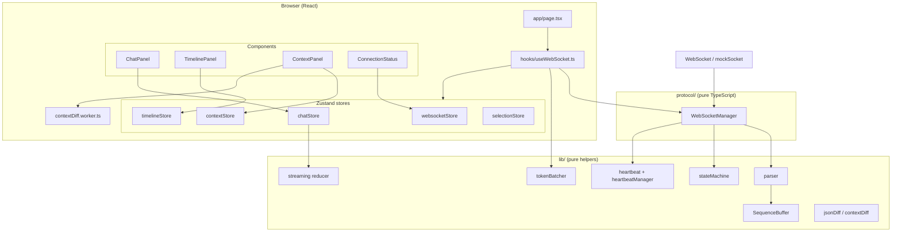
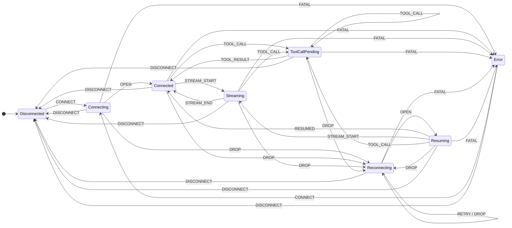
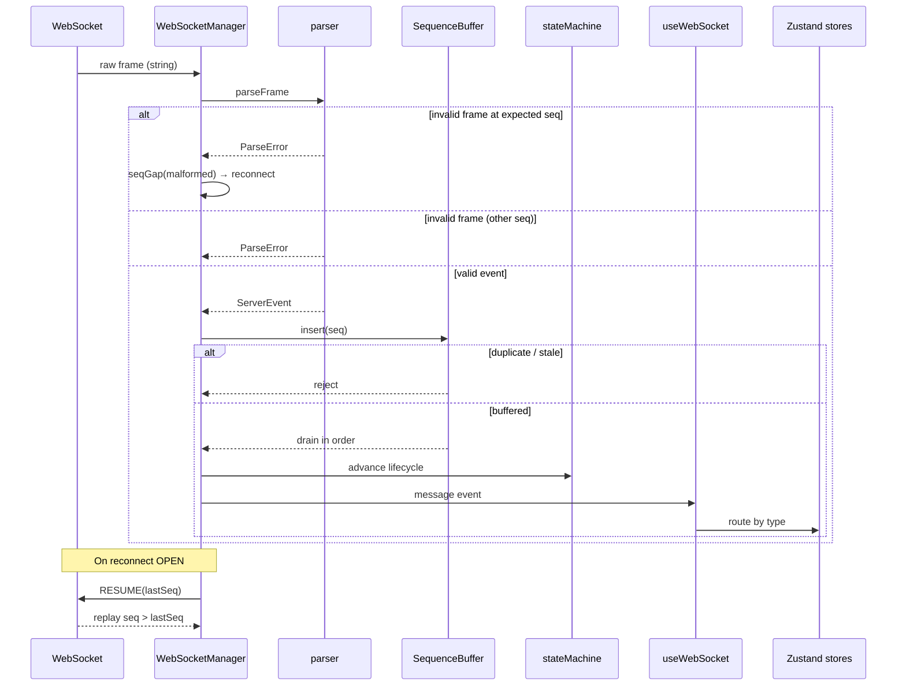
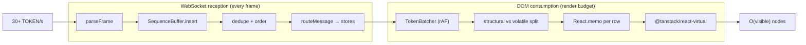

# Agent Console

A real-time agent console: streaming chat, a virtualized execution timeline, and a
live context inspector — all fed by a **resilient WebSocket protocol whose core is
completely isolated from React**.

The headline constraint: parsing, sequencing, liveness, and connection lifecycle live
in pure TypeScript under `protocol/`. They import nothing from React, Next, or
Zustand, and run end-to-end in Node tests. ESLint enforces the boundary.

## Stack

| Layer | Choice |
| ----- | ------ |
| Framework | Next.js 15 (App Router), React 19 |
| Language | TypeScript strict (`noUncheckedIndexedAccess`, `exactOptionalPropertyTypes`) |
| Styling | Tailwind CSS |
| State | Zustand (no Redux, no Context API) |
| Lists | `@tanstack/react-virtual` |
| Diff | Web Worker for large context snapshots (>500 KB) |
| Highlighting | Shiki |
| Tests | Vitest (214 tests, >90% coverage on protocol logic) |

No Redux. No Context API. No AI SDK.

## Quick start

```bash
npm install        # uses legacy-peer-deps (react-json-tree peer range)
npm run dev        # http://localhost:3000
```

This folder is a **standalone git repository** on branch `main`. Work from here
directly — it is no longer meant to be tracked by the parent `~/` git repo.

The app ships with a **mock agent socket** (`lib/mockSocket.ts`) that delivers frames
out of order, sends heartbeats, and replays on `RESUME` — so you can see the
protocol layer working without a backend.

Want a **real LLM** instead? A drop-in backend lives in [`backend/`](./backend)
and speaks the same wire protocol using **Ollama (local, no key)** or
**Gemini (free key)**, with real tools (calculator + Wikipedia). See
[Real agent backend](#real-agent-backend) below.

```bash
npm run typecheck
npm run lint
npm test
npm run test:coverage   # protocol logic coverage thresholds enforced
npm run verify          # typecheck + lint + test + production build (pre-demo)
```

## Demo walkthrough

No backend required — a **scripted demo** runs in the browser (`lib/demoScenario.ts` +
`lib/mockSocket.ts`). Same result every run.

**Use case:** research assistant — *"Who was Ada Lovelace and what is 2^20?"*
→ `calculator` tool → `wikipedia_lookup` tool → synthesized answer. Tokens still
arrive out of order; context snapshots evolve; timeline and diff panels light up.

```bash
npm install
npm run verify          # typecheck + lint + test + production build
npm run dev             # http://localhost:3000
```

Within ~1 s you should see **Connected**, an intro in Chat, and revision `1` in
Context. The input is prefilled — press **Enter** to send.

| Step | What to do | What to notice |
| ---- | ---------- | -------------- |
| 1 | Open the app | Chat, Timeline, Context; header shows connection state + `seq #`. |
| 2 | Press **Enter** (or Send) | Out-of-order tokens; `calculator` then `wikipedia_lookup`; context rev bumps. |
| 3 | Click a timeline row | Cross-panel highlight into chat. |
| 4 | Open Context | Revision picker + diff; toggle **follow latest** off to inspect older revs. |
| 5 | Optional: **Retry now** / throttle network | Reconnecting; transcript preserved; `RESUME` replays only missed seqs. |

Architecture notes: [DECISIONS.md](./DECISIONS.md).

## Real agent backend

By default the UI uses the in-browser scripted agent. Optionally point it at a
real LLM backend that emits the same wire-protocol frames.

### 1. Start the backend

```bash
cd backend
npm install
cp .env.example .env
```

**Ollama (local, free, no key)** — install [ollama.com](https://ollama.com), then:

```bash
ollama pull llama3.1        # tool-capable model
npm run dev                 # PROVIDER=ollama is the default
```

**Gemini (free key)** — get one at
[aistudio.google.com/apikey](https://aistudio.google.com/apikey):

```bash
# in backend/.env:  PROVIDER=gemini  and  GEMINI_API_KEY=...
npm run dev
```

The server listens on `ws://localhost:8787`.

### 2. Point the UI at it

```bash
# in the project root
cp .env.local.example .env.local     # NEXT_PUBLIC_AGENT_WS_URL=ws://localhost:8787
npm run dev
```

Ask something like `what is 128 * 47?` or `who was Ada Lovelace?` to see real
streaming tokens, tool calls, and results. Delete `.env.local` to return to the
scripted demo.

### No model handy?

```bash
cd backend && npm run smoke      # full tool-calling loop against a fake provider
```

See [backend/README.md](./backend/README.md) for details, tools, and deployment.

### Swap in any other backend

Set `NEXT_PUBLIC_AGENT_WS_URL` to any endpoint that speaks the wire protocol in
[`protocol/types.ts`](./protocol/types.ts). The `WebSocketManager` and stores are
unchanged.

## Architecture



### Dependency rule (one direction only)

```
protocol/   ──►  pure TS, no React/Zustand
   ▲
stores/     ──►  domain state, imports protocol types + lib reducers
   ▲
hooks/      ──►  the ONLY place React touches the socket
   ▲
components/ ──►  render-only, narrow store subscriptions
```

`protocol/` may only import from `protocol/` and `lib/`. Enforced in
`eslint.config.mjs` via `no-restricted-imports`.

## WebSocket state machine

Connection lifecycle is a single explicit 8-state FSM — no boolean flags like
`isConnected` / `isReconnecting`.



## Protocol pipeline



### Wire schema (`protocol/types.ts`)

**Server events:** `TOKEN`, `TOOL_CALL`, `TOOL_STATUS`, `TOOL_RESULT`,
`STREAM_END`, `CONTEXT_SNAPSHOT`, `PING`, `ERROR`

#### Tool-call events

Tool execution is reported explicitly by the server. The client never infers
"running" on its own.

```
queued ──▶ running ──▶ succeeded | failed
   └──────────┴──────▶ cancelled
```

| Frame | Carries | Meaning |
| ----- | ------- | ------- |
| `TOOL_CALL` | `callId`, `name`, `args` | Tool announced; status is `queued` |
| `TOOL_STATUS` | `callId`, `name`, `args`, `status`, `detail?`, `progress?` (0–1) | Explicit status change or progress tick |
| `TOOL_RESULT` | `callId`, `ok`, `result?` / `error?`, `durationMs` | Output; sets `succeeded` / `failed` |

`TOOL_STATUS` is self-describing. It carries the tool name and arguments, so
a client can render the call even if it is the first frame seen for that
`callId`. Lifecycle rules live in `protocol/toolStatus.ts` and are shared by
the chat and timeline stores. Statuses only move forward, terminal statuses
are final, and repeated `running` frames update `detail`/`progress`. Replayed
or late frames therefore never move a card backwards. `cancelled` has no
`TOOL_RESULT` and ends the `ToolCallPending` FSM state on its own. `TOOL_ACK`
is delivery-only: tool cards track it as a separate `acknowledged` flag, not
as an execution status.

**Client messages:** `USER_MESSAGE`, `PONG`, `TOOL_ACK`, `RESUME`

| Module | Role |
| ------ | ---- |
| `parser.ts` | Strict frame validation; never throws |
| `sequenceBuffer.ts` | Gap-aware ordering, duplicate/stale rejection |
| `reorderBuffer.ts` | Push-based variant with overflow/timeout gap skip |
| `stateMachine.ts` | Declarative transition table |
| `heartbeat.ts` | Client liveness (silence → dead) |
| `heartbeatManager.ts` | Server PING → client PONG (echo nonce) |
| `webSocketManager.ts` | Composes all of the above; gap policy, remount-safe watermark |

## Data flow: socket → screen

Two distinct consumption paths exist. See [DECISIONS.md](./DECISIONS.md) for the
full rationale.



**WebSocket reception** must be correct on every frame: ordering, deduplication,
lifecycle transitions, and store writes.

**DOM consumption** is budgeted: token bursts batch to one flush per animation
frame; list shells subscribe to structural state only; each row subscribes to its
own `items[id]`; virtualization caps painted nodes.

## UI panels

### Chat

Virtualized transcript. `TranscriptRow` subscribes per message id; `MessageRow`
uses field-wise `React.memo` so completed messages never repaint when another
stream receives tokens.

### Timeline

Virtualized trace of messages and tool calls. `timelineStore` splits structural
(`order`, `index`) from volatile (`items`). `syncMessage` mutates only the active
row — the panel shell does not re-render at 30+ events/sec.

### Context Inspector

Bounded snapshot history (50 revisions, clamped inspector on eviction), recursive
JSON diff (`lib/contextDiff.ts`), lazy tree expansion, virtualization. Large
payloads diff off-thread via Web Worker.

## Project layout

```
app/           Next.js routes (composition only)
components/    Chat, Timeline, Context, ToolCards, Connection
protocol/      Pure transport core
stores/        Zustand domain stores
hooks/         useWebSocket, useContextDiff
lib/           Reducers, diff, batching, mock socket
workers/       contextDiff.worker.ts
tests/         Vitest unit tests
```

## Scripts

| Command | Purpose |
| ------- | ------- |
| `npm run dev` | Dev server |
| `npm run build` | Production build |
| `npm run typecheck` | `tsc --noEmit` |
| `npm run lint` | ESLint + protocol import boundary |
| `npm test` | Vitest (214 tests) |
| `npm run test:coverage` | Coverage with 90% thresholds on protocol logic |
| `npm run verify` | Full pre-demo check: typecheck, lint, test, build |

## Tests

| Suite | Covers |
| ----- | ------ |
| `sequenceBuffer.test.ts` | Ordering, gaps, duplicates, chaos runs |
| `stateMachine.test.ts` | Full FSM transition matrix |
| `webSocketManager.test.ts` | Connect, dedupe, heartbeat, backoff, resume |
| `heartbeatManager.test.ts` | PING/PONG, malformed frames |
| `reconnect.test.ts` | Store idempotency, mock RESUME replay |
| `contextStore.test.ts` | Snapshot dedupe, revision clamp on eviction |
| `jsonDiff.test.ts` | Recursive diff engine |
| `streaming.test.ts` | Transcript reducer, tool lifecycle |
| `toolStatus.test.ts` | Tool status rules, `TOOL_STATUS` parsing, timeline tool nodes |
| `tokenBatcher.test.ts` | rAF coalescing |
| `protocolLogic.test.ts` | Parser, type guards, liveness |

## Further reading

- [DECISIONS.md](./DECISIONS.md) — why Zustand, SequenceBuffer, the FSM, replay,
  DOM vs socket consumption, and scaling to 50 agents / 100× longer streams.
