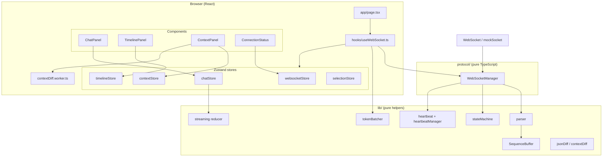
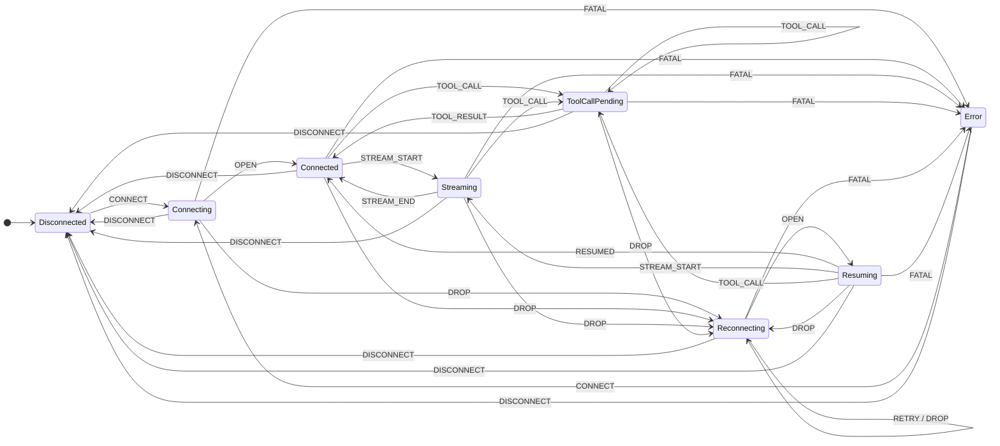
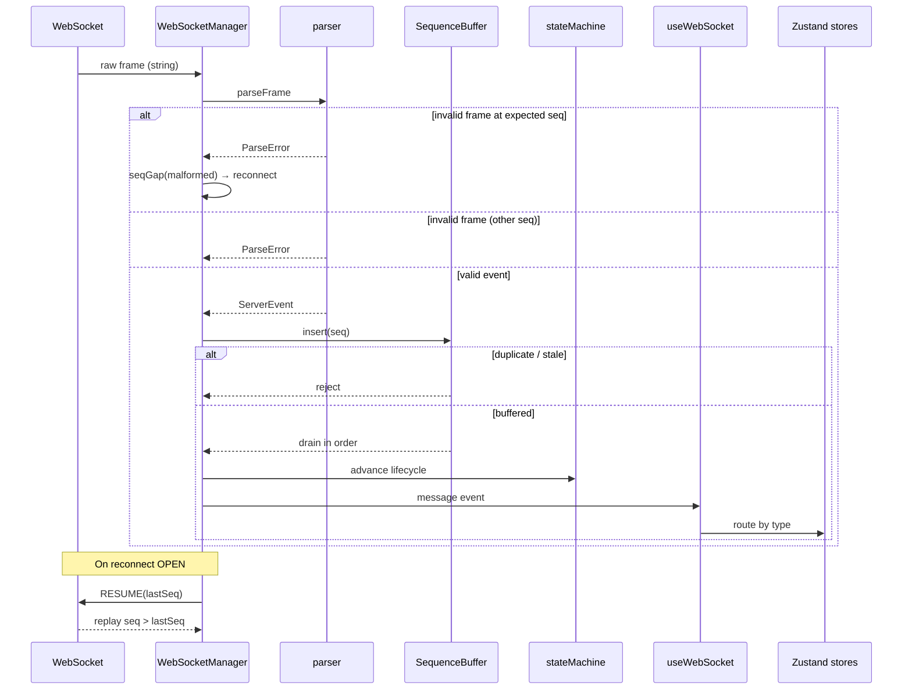
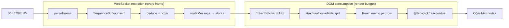

# Agent Console

A real-time agent console: streaming chat, a virtualized execution timeline, and a
live context inspector — all fed by a **resilient WebSocket protocol whose core is
completely isolated from React**.

The headline constraint: parsing, sequencing, liveness, and connection lifecycle live
in pure TypeScript under `protocol/`. They import nothing from React, Next, or
Zustand, and run end-to-end in Node tests. ESLint enforces the boundary.

## Stack

| Layer | Choice |
| ----- | ------ |
| Framework | Next.js 15 (App Router), React 19 |
| Language | TypeScript strict (`noUncheckedIndexedAccess`, `exactOptionalPropertyTypes`) |
| Styling | Tailwind CSS |
| State | Zustand (no Redux, no Context API) |
| Lists | `@tanstack/react-virtual` |
| Diff | Web Worker for large context snapshots (>500 KB) |
| Highlighting | Shiki |
| Tests | Vitest (187 tests, >90% coverage on protocol logic) |

No Redux. No Context API. No AI SDK.

## Quick start

```bash
npm install        # uses legacy-peer-deps (react-json-tree peer range)
npm run dev        # http://localhost:3000
```

This folder is a **standalone git repository** on branch `main`. Work from here
directly — it is no longer meant to be tracked by the parent `~/` git repo.

The app ships with a **mock agent socket** (`lib/mockSocket.ts`) that delivers frames
out of order, sends heartbeats, and replays on `RESUME` — so you can see the
protocol layer working without a backend.

```bash
npm run typecheck
npm run lint
npm test
npm run test:coverage   # protocol logic coverage thresholds enforced
npm run verify          # typecheck + lint + test + production build (pre-demo)
```

## Presenting / demo walkthrough

No backend required — the mock agent (`lib/mockSocket.ts`) exercises the full
protocol stack: out-of-order tokens, tool calls, context snapshots, heartbeats,
and `RESUME` replay on reconnect.

### Before you present

```bash
npm install
npm run verify          # must pass — 187 tests + production build
npm run dev             # http://localhost:3000
```

Use a fresh browser tab. Within ~1 s you should see **Connected** in the header,
an intro message in Chat, and revision `1` in Context.

### 5-minute demo script

| Step | What to do | What to point out |
| ---- | ---------- | ----------------- |
| 1 | Open the app | Three panels: Chat, Timeline, Context. Header shows connection state + `seq #`. |
| 2 | Read the intro | Mock agent streams tokens **out of order**; `SequenceBuffer` reorders before any store write. |
| 3 | Send a message (e.g. `weather in Tokyo`) | Streaming tokens, two tool cards (`search_web`, `fetch_page`), timeline rows appear in order. |
| 4 | Click a timeline row | Cross-panel highlight — chat scrolls to the matching message/tool. |
| 5 | Open Context panel | Revision picker + diff (green/red/yellow). Toggle **follow latest** off and pick an older rev. |
| 6 | (Optional) Click **Retry now** while connected, or throttle network in DevTools | **Reconnecting** banner; transcript preserved; `RESUME` replays only missed seqs. |

### Talking points

- **`protocol/` is pure TypeScript** — 187 unit tests, >90% coverage, zero React imports (ESLint-enforced).
- **Strict ordering** — `SequenceBuffer` never skips seqs; gap policy reconnects instead of corrupting state.
- **Render budget** — `TokenBatcher` + per-row subscriptions + virtualization keep UI smooth at 30+ TOKEN/s.
- **Architecture docs** — [DECISIONS.md](./DECISIONS.md) explains Zustand, FSM, replay, and scaling.

### Swap in a real backend

In `app/page.tsx`, remove `socketFactory: mockSocketFactory` and set `url` to your
WebSocket endpoint. The same `WebSocketManager` and stores handle the wire protocol.

## Architecture



### Dependency rule (one direction only)

```
protocol/   ──►  pure TS, no React/Zustand
   ▲
stores/     ──►  domain state, imports protocol types + lib reducers
   ▲
hooks/      ──►  the ONLY place React touches the socket
   ▲
components/ ──►  render-only, narrow store subscriptions
```

`protocol/` may only import from `protocol/` and `lib/`. Enforced in
`eslint.config.mjs` via `no-restricted-imports`.

## WebSocket state machine

Connection lifecycle is a single explicit 8-state FSM — no boolean flags like
`isConnected` / `isReconnecting`.



## Protocol pipeline



### Wire schema (`protocol/types.ts`)

**Server events:** `TOKEN`, `TOOL_CALL`, `TOOL_RESULT`, `STREAM_END`,
`CONTEXT_SNAPSHOT`, `PING`, `ERROR`

**Client messages:** `USER_MESSAGE`, `PONG`, `TOOL_ACK`, `RESUME`

| Module | Role |
| ------ | ---- |
| `parser.ts` | Strict frame validation; never throws |
| `sequenceBuffer.ts` | Gap-aware ordering, duplicate/stale rejection |
| `reorderBuffer.ts` | Push-based variant with overflow/timeout gap skip |
| `stateMachine.ts` | Declarative transition table |
| `heartbeat.ts` | Client liveness (silence → dead) |
| `heartbeatManager.ts` | Server PING → client PONG (echo nonce) |
| `webSocketManager.ts` | Composes all of the above; gap policy, remount-safe watermark |

## Data flow: socket → screen

Two distinct consumption paths exist. See [DECISIONS.md](./DECISIONS.md) for the
full rationale.



**WebSocket reception** must be correct on every frame: ordering, deduplication,
lifecycle transitions, and store writes.

**DOM consumption** is budgeted: token bursts batch to one flush per animation
frame; list shells subscribe to structural state only; each row subscribes to its
own `items[id]`; virtualization caps painted nodes.

## UI panels

### Chat

Virtualized transcript. `TranscriptRow` subscribes per message id; `MessageRow`
uses field-wise `React.memo` so completed messages never repaint when another
stream receives tokens.

### Timeline

Virtualized trace of messages and tool calls. `timelineStore` splits structural
(`order`, `index`) from volatile (`items`). `syncMessage` mutates only the active
row — the panel shell does not re-render at 30+ events/sec.

### Context Inspector

Bounded snapshot history (50 revisions, clamped inspector on eviction), recursive
JSON diff (`lib/contextDiff.ts`), lazy tree expansion, virtualization. Large
payloads diff off-thread via Web Worker.

## Project layout

```
app/           Next.js routes (composition only)
components/    Chat, Timeline, Context, ToolCards, Connection
protocol/      Pure transport core
stores/        Zustand domain stores
hooks/         useWebSocket, useContextDiff
lib/           Reducers, diff, batching, mock socket
workers/       contextDiff.worker.ts
tests/         Vitest unit tests
```

## Scripts

| Command | Purpose |
| ------- | ------- |
| `npm run dev` | Dev server |
| `npm run build` | Production build |
| `npm run typecheck` | `tsc --noEmit` |
| `npm run lint` | ESLint + protocol import boundary |
| `npm test` | Vitest (187 tests) |
| `npm run test:coverage` | Coverage with 90% thresholds on protocol logic |
| `npm run verify` | Full pre-demo check: typecheck, lint, test, build |

## Tests

| Suite | Covers |
| ----- | ------ |
| `sequenceBuffer.test.ts` | Ordering, gaps, duplicates, chaos runs |
| `stateMachine.test.ts` | Full FSM transition matrix |
| `webSocketManager.test.ts` | Connect, dedupe, heartbeat, backoff, resume |
| `heartbeatManager.test.ts` | PING/PONG, malformed frames |
| `reconnect.test.ts` | Store idempotency, mock RESUME replay |
| `contextStore.test.ts` | Snapshot dedupe, revision clamp on eviction |
| `jsonDiff.test.ts` | Recursive diff engine |
| `streaming.test.ts` | Transcript reducer, tool lifecycle |
| `tokenBatcher.test.ts` | rAF coalescing |
| `protocolLogic.test.ts` | Parser, type guards, liveness |

## Further reading

- [DECISIONS.md](./DECISIONS.md) — why Zustand, SequenceBuffer, the FSM, replay,
  DOM vs socket consumption, and scaling to 50 agents / 100× longer streams.
